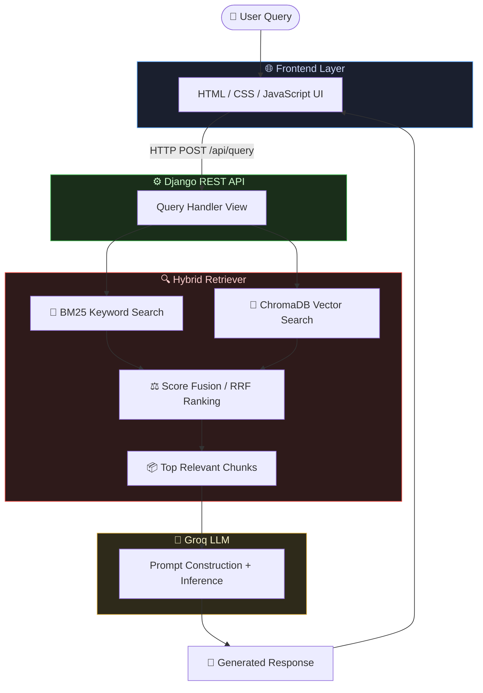
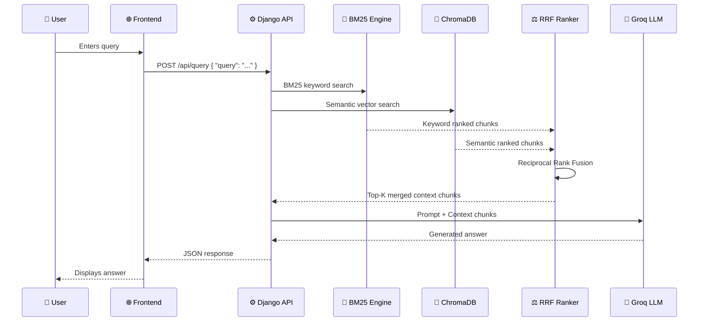

<div align="center">

# 🧠 ContextIQ
### AI-Powered Hybrid Knowledge Retrieval Assistant

[](https://python.org)
[](https://www.django-rest-framework.org/)
[](https://www.trychroma.com/)
[](https://groq.com/)
[](https://www.docker.com/)
[](https://opensource.org/licenses/MIT)

<br/>

> **ContextIQ** is a production-ready Hybrid RAG (Retrieval-Augmented Generation) system that fuses **BM25 keyword search** with **ChromaDB semantic vector search** to deliver contextually precise, LLM-powered answers — all served through a clean REST API and a lightweight web frontend.

<br/>


</div>

---

## 📌 Table of Contents

- [✨ Key Features](#-key-features)
- [🛠 Tech Stack](#-tech-stack)
- [🏗 System Architecture](#-system-architecture)
- [🔍 Hybrid Search Workflow](#-hybrid-search-workflow)
- [🚀 Installation Guide](#-installation-guide)
- [⚙️ Environment Variables](#️-environment-variables)
- [▶️ Running the Backend](#️-running-the-backend)
- [🌐 Running the Frontend](#-running-the-frontend)
- [🐳 Docker Setup](#-docker-setup)
- [📡 API Endpoints](#-api-endpoints)
- [📁 Project Structure](#-project-structure)
- [🔮 Future Improvements](#-future-improvements)
- [📸 Screenshots](#-screenshots)
- [👤 Author](#-author)

---

## ✨ Key Features

- 🔀 **Hybrid Retrieval** — Combines BM25 keyword search + ChromaDB semantic vector search for maximum recall and precision
- ⚡ **Groq-Powered LLM** — Ultra-fast inference using Groq's LPU for near real-time response generation
- 📄 **Document Ingestion** — Upload and index custom documents (PDF, TXT, DOCX) into the knowledge base
- 🧮 **Score Fusion Ranking** — Reciprocal Rank Fusion (RRF) merges results from both retrieval methods intelligently
- 🧱 **Django REST Backend** — Clean, modular REST API with proper serialization and error handling
- 🌐 **Lightweight Frontend** — Vanilla HTML/CSS/JS UI — no framework bloat, fast and portable
- 🐳 **Dockerized** — Fully containerized for one-command deployment
- 🔒 **Environment-safe** — API keys and secrets managed via `.env` — never hardcoded

---

## 🛠 Tech Stack

| Layer | Technology | Purpose |
|---|---|---|
| **Backend** | Python 3.10+, Django REST Framework | API server, routing, business logic |
| **Vector DB** | ChromaDB | Semantic embedding storage and retrieval |
| **Embeddings** | Sentence Transformers (`all-MiniLM-L6-v2`) | Dense vector generation |
| **Keyword Search** | BM25 (rank_bm25) | Sparse lexical retrieval |
| **LLM API** | Groq (LLaMA3 / Mixtral) | Response generation |
| **Frontend** | HTML, CSS, JavaScript | User interface |
| **Containerization** | Docker, Docker Compose | Deployment |

---

## 🏗 System Architecture



---

## 🔍 Hybrid Search Workflow



---

## 🚀 Installation Guide

### Prerequisites

- Python 3.10+
- pip / virtualenv
- Docker & Docker Compose (for containerized setup)
- Groq API Key → [Get it here](https://console.groq.com/)

### 1. Clone the Repository

```bash
git clone https://github.com/DevByShree/contextiq.git
cd contextiq
```

### 2. Create a Virtual Environment

```bash
python -m venv venv

# Activate
# Linux/macOS:
source venv/bin/activate
# Windows:
venv\Scripts\activate
```

### 3. Install Dependencies

```bash
pip install -r requirements.txt
```

---

## ⚙️ Environment Variables

Create a `.env` file in the root directory:

```env
# Groq LLM
GROQ_API_KEY=your_groq_api_key_here
GROQ_MODEL=llama3-8b-8192

# Django
SECRET_KEY=your_django_secret_key
DEBUG=True
ALLOWED_HOSTS=localhost,127.0.0.1

# ChromaDB
CHROMA_PERSIST_DIR=./chroma_store

# Retrieval Config
TOP_K_RESULTS=5
BM25_WEIGHT=0.4
VECTOR_WEIGHT=0.6
```

> ⚠️ Never commit your `.env` file. It's included in `.gitignore` by default.

---

## ▶️ Running the Backend

```bash
# Apply database migrations
python manage.py migrate

# Ingest documents into knowledge base (run once)
python manage.py ingest_documents --dir ./documents

# Start the Django development server
python manage.py runserver
```

Backend will be running at: `http://127.0.0.1:8000`

---

## 🌐 Running the Frontend

The frontend is a standalone static UI — no build step required.

```bash
# Option 1: Open directly in browser
open frontend/index.html

# Option 2: Serve with Python's HTTP server
cd frontend
python -m http.server 5500
```

Frontend will be accessible at: `http://127.0.0.1:5500`

> Ensure the API base URL in `frontend/js/config.js` matches your backend server address.

---

## 🐳 Docker Setup

### Build and Run with Docker Compose

```bash
# Build and start all services
docker-compose up --build

# Run in detached mode
docker-compose up -d --build

# Stop all services
docker-compose down
```

### `docker-compose.yml` Overview

```yaml
version: "3.9"
services:
  backend:
    build: .
    ports:
      - "8000:8000"
    env_file:
      - .env
    volumes:
      - ./chroma_store:/app/chroma_store
      - ./documents:/app/documents

  frontend:
    image: nginx:alpine
    ports:
      - "5500:80"
    volumes:
      - ./frontend:/usr/share/nginx/html
```

---

## 📡 API Endpoints

### Base URL: `http://localhost:8000/api/`

| Method | Endpoint | Description |
|---|---|---|
| `POST` | `/api/query/` | Submit a query, get an AI-generated answer |
| `POST` | `/api/ingest/` | Upload and index a document |
| `GET` | `/api/documents/` | List all indexed documents |
| `DELETE` | `/api/documents/<id>/` | Remove a document from the knowledge base |
| `GET` | `/api/health/` | Health check endpoint |

### Example: Query Request

```bash
curl -X POST http://localhost:8000/api/query/ \
  -H "Content-Type: application/json" \
  -d '{"query": "What is the refund policy?"}'
```

```json
{
  "query": "What is the refund policy?",
  "answer": "Based on the provided documents, the refund policy states...",
  "sources": [
    { "document": "policy.pdf", "chunk": "...", "score": 0.91 },
    { "document": "faq.txt",    "chunk": "...", "score": 0.87 }
  ],
  "retrieval_method": "hybrid",
  "tokens_used": 312
}
```

### Example: Document Ingestion

```bash
curl -X POST http://localhost:8000/api/ingest/ \
  -F "file=@./documents/company_policy.pdf"
```

```json
{
  "status": "success",
  "document": "company_policy.pdf",
  "chunks_indexed": 47
}
```

---

## 📁 Project Structure

```
contextiq/
│
├── backend/                        # Django Backend
│   ├── manage.py
│   ├── requirements.txt
│   ├── Dockerfile
│   ├── .env.example
│   │
│   ├── config/                     # Django project settings
│   │   ├── settings.py
│   │   ├── urls.py
│   │   └── wsgi.py
│   │
│   └── api/                        # Core application
│       ├── views.py                # API view handlers
│       ├── urls.py                 # Route definitions
│       ├── serializers.py          # DRF serializers
│       │
│       ├── retriever/              # Hybrid Retrieval Engine
│       │   ├── hybrid_retriever.py # RRF score fusion logic
│       │   ├── bm25_engine.py      # BM25 keyword search
│       │   └── vector_engine.py    # ChromaDB vector search
│       │
│       ├── ingestion/              # Document processing
│       │   ├── document_loader.py  # PDF, TXT, DOCX loaders
│       │   └── chunker.py          # Text chunking strategies
│       │
│       └── llm/                    # LLM interface
│           ├── groq_client.py      # Groq API wrapper
│           └── prompt_builder.py   # Prompt templates
│
├── frontend/                       # Static Frontend
│   ├── index.html
│   ├── css/
│   │   └── style.css
│   └── js/
│       ├── main.js                 # Query submission logic
│       └── config.js               # API base URL config
│
├── documents/                      # Sample knowledge base documents
│   └── sample.pdf
│
├── chroma_store/                   # Persisted ChromaDB index (gitignored)
│
├── docker-compose.yml
└── README.md
```

---

## 🔮 Future Improvements

- [ ] 🔐 **JWT Authentication** — Secure multi-user access with token-based auth
- [ ] 📊 **Retrieval Analytics Dashboard** — Visualize query logs, source attribution, and chunk relevance scores
- [ ] 🧩 **Pluggable LLM Support** — Add OpenAI, Ollama (local), and Anthropic Claude as switchable backends
- [ ] 🌍 **Multi-language Support** — Multilingual embeddings and cross-lingual retrieval
- [ ] 💬 **Conversation Memory** — Maintain multi-turn dialogue context across queries
- [ ] ☁️ **Cloud Deployment** — CI/CD pipeline with deployment to AWS/GCP/Render
- [ ] 📂 **Advanced Chunking** — Semantic chunking and parent-document retriever strategies
- [ ] 🔁 **Re-Ranking Layer** — Add a cross-encoder re-ranker (e.g., `ms-marco-MiniLM`) after hybrid retrieval

---

## 📸 Screenshots

> _Add your screenshots here after setup_

| Query Interface | Retrieved Sources | Document Upload |
|---|---|---|
|  |  |  |

---

## 👤 Author

<div align="center">

**Shree Joshi**
*AI/ML Engineer | Agentic AI Enthusiast*

[](https://github.com/DevByShree)
[](https://linkedin.com/in/shreejoshi)
[](mailto:shreejoshi1805@gmail.com)

</div>

---

<div align="center">

**Built with 🧠 RAG + ⚡ Groq + ❤️ Python**

*If this project helped you, please consider giving it a ⭐ — it means a lot!*

</div>
